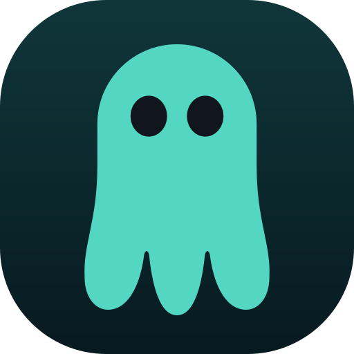

<p align="center">
  
</p>

<h1 align="center">GhostBox</h1>

<p align="center"><strong>v1.4.8 Alpha · Linux x86_64/ARM64 · Windows x64 · Xray-core + sing-box</strong></p>

## Русский

GhostBox — VPN-клиент на Flutter с ядрами Xray и sing-box. Linux поддерживает оба ядра. На Android подключение выполняется через системный `VpnService` и sing-box libbox; Windows поддерживает системный прокси и TUN через Wintun с запросом прав администратора. На macOS доступны прокси и TUN через привилегированный sing-box процесс. На iOS sing-box запускается в системном Packet Tunnel extension; для установки и распространения нужен Apple Developer team с включёнными Network Extension и App Groups.

### Возможности

- Импорт VLESS, VMess, Trojan, Shadowsocks, JSON-профилей и URL-подписок; несколько подписок и автообновление.
- Режимы TUN, локальный прокси, системный прокси и Mixed.
- Xray по умолчанию; Xray XHTTP/REALITY и Linux TUN через sing-box-маршрутизатор.
- Настройки DNS, маршрутов, DNS-блоклистов, локального порта, журналов и мягкого лимита памяти ядра.
- Единые правила split tunneling по доменам и IP/CIDR на всех платформах; поддерживается импорт JSON-списков Amnezia.
- Проверка серверов, журнал в файл, история последних подключений и просмотр сгенерированных конфигов.
- Необязательный индикатор RAM ядер на главном экране.
- Kill Switch для Linux и Windows TUN/Mixed. Его нельзя включить вместе с правилами split tunneling, которые отправляют трафик напрямую.
- Данные подписки — трафик, срок действия, устройства, сайт и поддержка — отображаются, только если их прислал провайдер.
- Скрипты сборки Xray/sing-box для Windows и macOS, sing-box libbox для Android и Apple.

Windows-сборка включает установщик и системный прокси текущего пользователя. При выборе TUN приложение запросит права администратора Windows. Android APK собирается локально вместе с libbox; общий workflow пакетов его не собирает и не публикует. Сборка и статус платформ описаны в [deploy/PLATFORMS.md](deploy/PLATFORMS.md).

В списках маршрутов `example.com` включает поддомены, `*.example.com` — только поддомены, `full:example.com` — только точный hostname. IP/CIDR правила проверяются по адресу назначения. Доменные правила используют DNS-ответы и видимые HTTP/TLS/QUIC hostname; зашифрованный DNS и ECH могут скрыть имя сайта, поэтому для таких адресов используй IP/CIDR. На iOS выбор отдельных приложений доступен только в управляемом устройстве.

Поддержка протоколов и транспортов зависит от ядра и его параметров сборки. Для XHTTP и REALITY выбирай Xray: поставляемая сборка sing-box может не содержать дополнительных тегов XHTTP/uTLS.

### Установка

Для локальной сборки выбери платформу одной командой:

```bash
./tool/build.sh
```

Или укажи `linux`, `android`, `windows`, `macos` либо `ios`. Скрипт скачает
Go/Flutter зависимости и ядра, соберёт доступный для текущей ОС пакет; Android
SDK можно установить через `tool/setup_android.sh`. Linux создаёт AppImage для
текущей архитектуры (x86_64 или ARM64) и
предлагает установить его и один раз выдать ядрам право TUN. Windows и Apple
приложения собираются на Windows и macOS соответственно; для Windows на Linux
используй GitHub Actions. Apple dev-сборки доступны в **Actions → Build GhostBox
for Apple platforms**. macOS выдаёт ad-hoc подписанный `.app` для проверки;
iOS собирается как unsigned app вместе с Packet Tunnel extension и libbox XCFramework. Для установки нужен Apple Developer team с provisioning profiles для VPN extension и App Group.

Скачай подходящий AppImage в **Actions → Build GhostBox packages → Artifacts**:
`x86_64` подходит для Intel/AMD 64-bit, `aarch64` — для ARM64 Linux.

```bash
chmod +x GhostBox-1.4.8-alpha-linux-x86_64.AppImage
./GhostBox-1.4.8-alpha-linux-x86_64.AppImage
```

Пакеты для x86_64 и ARM64 содержат нативные бинарники и не взаимозаменяемы.
Чтобы установить приложение в меню рабочего стола без прав root, из клона репозитория выполни:

```bash
./tool/install_appimage.sh ./dist/GhostBox-1.4.8-alpha-linux-x86_64.AppImage
```

Добавь ссылку-подписку или сервер, выбери профиль и нажми кнопку подключения. TUN включён по умолчанию. Если AppImage не запускается из-за отсутствия FUSE, попробуй `APPIMAGE_EXTRACT_AND_RUN=1 ./GhostBox-1.4.8-alpha-linux-x86_64.AppImage`.

### TUN без запуска VPN от root

Linux требует однократно выдать ядру `CAP_NET_ADMIN`, чтобы оно могло создать TUN-интерфейс и настроить маршруты. Сначала запусти AppImage один раз: он скопирует ядро в каталог пользователя. Затем выполни:

```bash
sudo setcap cap_net_admin+ep "$HOME/.local/share/ghostbox-appimage/vendor/bin/sing-box"
getcap "$HOME/.local/share/ghostbox-appimage/vendor/bin/sing-box"
```

На Void Linux, если `setcap` не найден: `sudo xbps-install -S libcap-progs`. Если переменная `XDG_DATA_HOME` задана, путь будет `$XDG_DATA_HOME/ghostbox-appimage/vendor/bin/sing-box`. При ошибке прав приложение покажет команду для текущего пути и кнопку копирования. `sudo` нужен только для однократной выдачи capability; сам GhostBox и VPN затем работают от твоего пользователя. После обновления AppImage эту команду может потребоваться повторить. Устройство `/dev/net/tun` должно существовать.

Kill Switch пока работает в Linux с установленными `nftables` и `pkexec` и только в режимах TUN/Mixed. При включении он блокирует системный исходящий трафик вне `ghostbox0`; правило firewall переживает закрытие приложения и остаётся активным до выключения Kill Switch в настройках. После перезагрузки GhostBox попросит восстановить правило. Используй эту функцию только если понимаешь, что интернет останется заблокированным при выключенном VPN.

### Windows и Android

Чтобы собрать пакеты через GitHub Actions:

1. Закоммить и отправь изменения в репозиторий (`git push origin main`).
2. На GitHub открой **Actions → Build GhostBox packages → Run workflow**.
3. Выбери ветку `main` и нажми **Run workflow**.
4. Дождись завершения workflow, открой его запуск и скачай нужный артефакт: Linux x86_64/ARM64 AppImage, Windows x64 ZIP/установщик или macOS ARM64 ZIP.

Скрипт обработает только ZIP/TAR-архивы с именем, начинающимся на `GhostBox`, в `~/Downloads`. Он сложит сборки в `~/GhostBoxBin`, распакует вложенные архивы и удалит исходный архив только после успешной распаковки. Остальные загрузки останутся нетронутыми:

```bash
./tool/import_github_builds.sh
```

Артефакты ручного запуска хранятся 14 дней. Чтобы выпустить релиз, сначала закоммить изменения в `main`, затем запусти скрипт с коротким описанием обновления:

```bash
./tool/publish_release.sh "Исправлен split tunneling и ускорен запуск"
```

Скрипт отправит `main`, создаст версионный тег из `pubspec.yaml` и запустит GitHub Actions. Основной workflow соберёт Linux AppImage для x86_64 и ARM64, Windows installer `.exe` и ZIP и macOS ARM64 ZIP, затем создаст prerelease с версией в заголовке, описанием обновления, коммитами и файлами сборок. APK в общий workflow и релиз не входит: собирай его локально вместе с Android-ядрами:

```bash
./tool/build_android.sh
```

Готовый APK и его checksum появятся в `dist/android/GhostBox-Android-universal.apk` и `dist/android/GhostBox-Android-universal.apk.sha256`; предыдущие сборки сохраняются в `old/`. Чтобы автообновление нашло APK, загрузи оба файла в один GitHub Release без переименования. Нужны Flutter, Go, Java 17 и Android SDK/NDK (их можно подготовить через `tool/setup_android.sh`). Android требует API 24 или новее и включает sing-box XHTTP. Если локальный keystore не настроен, сборка подписывается Android Debug сертификатом из `~/.android/debug.keystore`; сохрани этот файл, чтобы последующие APK с этого компьютера могли обновлять друг друга. При подключении Android запросит разрешение на VPN и, если доступно, уведомления.

Для отдельного постоянного release-ключа создай keystore локально:

```bash
keytool -genkeypair -v -keystore "$HOME/.android/ghostbox-release.jks" -keyalg RSA -keysize 4096 -validity 10000 -alias ghostbox-release
```

`keytool` запросит пароли и данные владельца сертификата. Храни keystore и пароли в безопасном месте: без прежнего ключа Android не примет обновление поверх установленной версии.

### Сборка из исходников

Для локальной сборки используй скрипт. Он скачает зависимости, соберёт ядра и приложение, а на Linux создаст AppImage:

Для локальной проверки форка sing-box с XHTTP на Linux добавь `GHOSTBOX_BUILD_SING_BOX_LX=1` перед той же командой. Он будет собран в `vendor/experimental/linux/<arch>/sing-box-lx` и не попадёт в AppImage или GitHub-релизы.

```bash
./build.sh
```

Чтобы выбрать Linux без меню: `./build.sh linux`. После сборки установить AppImage в меню можно командой `./tool/install_appimage.sh ./dist/GhostBox-1.4.8-alpha-linux-x86_64.AppImage`. Для локальной Android-сборки запусти `./tool/build_android.sh`; требования платформ описаны в [deploy/PLATFORMS.md](deploy/PLATFORMS.md).

### Приватность и диагностика

Настройки и профили хранятся локально. User-Agent содержит имя, версию и номер сборки клиента; ID установки, ОС, версию ОС, модель системы и архитектуру GhostBox передаёт отдельными заголовками запросов подписки и XHTTP. На Linux модель берётся из системного DMI, если он доступен; иначе отправляется `Linux PC`. Клиент не отправляет MAC-адрес, серийный номер оборудования или имя компьютера. Панель провайдера должна поддерживать эти заголовки; у VLESS поверх обычного TLS/TCP нет универсального поля устройства.

Файл `.env` предназначен только для локальной разработки, исключён из Git и не встраивается в приложение. Не публикуй подписки, токены, приватные ключи и JSON с учётными данными. Перед передачей журналов удали из них секреты.

### Статус альфа-релиза

Текущая цель релиза — Linux desktop и Windows x64; macOS proxy-сборка и iOS unsigned-сборка доступны для разработки. Для установки iOS-сборки требуются Apple-подпись и provisioning profiles с Network Extension и App Groups. Альфа требует проверки на твоём сервере и сети; держи возможность вернуться к предыдущему VPN и не запускай два TUN-клиента одновременно. Подробности и шаги установки — в [RELEASE-ALPHA.md](RELEASE-ALPHA.md).

## English

GhostBox is a Flutter VPN client powered by Xray and sing-box. Linux supports both cores. Android connects through the system `VpnService` and sing-box libbox; Windows supports the current user's system proxy and TUN through Wintun with a Windows administrator prompt. macOS supports proxy modes and TUN through a privileged sing-box process. On iOS, sing-box runs inside a system Packet Tunnel extension. Installation and distribution require an Apple Developer team with Network Extension and App Groups enabled.

### Features

- Import VLESS, VMess, Trojan, Shadowsocks, JSON profiles and subscription URLs; manage multiple subscriptions and refresh them automatically.
- TUN, local proxy, system proxy and Mixed connection modes.
- Xray is the default core. Xray supports XHTTP/REALITY; Linux TUN can route through a sing-box bridge.
- DNS, routing, DNS blocklists, local port, logging and a soft core memory budget.
- Domain and IP/CIDR split tunneling, including Amnezia JSON route lists.
- Server checks, file-based logs, recent connection history and generated-config viewer.
- Optional live core RAM usage on the main screen.
- A Linux TUN/Mixed Kill Switch that uses the system firewall to block outbound traffic outside the tunnel while allowing the VPN endpoint.
- Provider metadata such as traffic, expiry, device limit, website and support is shown only when supplied by the provider.
- Build scripts for Windows/macOS Xray and sing-box, Android libbox, and the Apple Libbox XCFramework.

The Windows build includes an installer and the current user's system proxy. Selecting TUN prompts for administrator rights. Build Android APKs locally with libbox; the general package workflow does not build or publish them. See [deploy/PLATFORMS.md](deploy/PLATFORMS.md) for build commands and platform status.

Protocol and transport support depends on the selected core and its build options. Choose Xray for XHTTP and REALITY; the bundled sing-box build may not include optional XHTTP/uTLS tags.

### Install

Build locally with an interactive platform picker:

```bash
./tool/build.sh
```

You can also pass `linux`, `android`, `windows`, `macos`, or `ios`. The script
fetches Go/Flutter dependencies and core binaries, then builds what the current
host can produce. Android SDK setup is available through
`tool/setup_android.sh`. Linux creates an AppImage and offers to install it and
grant the core binaries TUN capability once. Windows and Apple app builds need
their native operating systems; use GitHub Actions for Windows from Linux. Apple
development artifacts are available in **Actions → Build GhostBox for Apple
platforms**. The macOS `.app` is ad-hoc signed for local testing; the iOS output
is only an unsigned compile artifact and libbox XCFramework, not a VPN release.

On Windows, run `build.bat` from the repository folder (or pass PowerShell
options such as `-SkipCoreBuild`). It invokes the native Windows build script;
Flutter, Go and Visual Studio's **Desktop development with C++** workload must
be installed. The portable ZIP is written to `dist`; Inno Setup is optional
and adds the installer `.exe`.

Download `GhostBox-1.4.8-alpha-linux-x86_64.AppImage` from GitHub Releases and run:

```bash
chmod +x GhostBox-1.4.8-alpha-linux-x86_64.AppImage
./GhostBox-1.4.8-alpha-linux-x86_64.AppImage
```

To add GhostBox to the desktop app menu without root access, run this from a repository checkout:

```bash
./tool/install_appimage.sh ./dist/GhostBox-1.4.8-alpha-linux-x86_64.AppImage
```

On macOS, install a built `.app` bundle or ZIP into `/Applications` and launch it with:

```bash
./tool/install_macos.sh ./dist/GhostBox-1.4.8-alpha-macOS-arm64.zip
```
The script asks for administrator authorization to replace `/Applications/GhostBox.app`.

Add a subscription URL or server, select a profile and press Connect. TUN is enabled by default. If AppImage cannot start because FUSE is unavailable, try `APPIMAGE_EXTRACT_AND_RUN=1 ./GhostBox-1.4.8-alpha-linux-x86_64.AppImage`.

### TUN without running the VPN as root

Linux requires a one-time `CAP_NET_ADMIN` capability so the core can create a TUN interface and configure routes. Launch the AppImage once to copy its core into your user data directory, then run:

```bash
sudo setcap cap_net_admin+ep "$HOME/.local/share/ghostbox-appimage/vendor/bin/sing-box"
getcap "$HOME/.local/share/ghostbox-appimage/vendor/bin/sing-box"
```

On Void Linux, install `libcap-progs` if `setcap` is missing: `sudo xbps-install -S libcap-progs`. If `XDG_DATA_HOME` is set, use `$XDG_DATA_HOME/ghostbox-appimage/vendor/bin/sing-box`. On a permissions error, the app shows the exact command for the current path with a copy button. `sudo` is needed only once to grant the capability; GhostBox and the VPN then run as your normal user. Repeat the command after an AppImage update if its core binary changes. `/dev/net/tun` must exist.

The Kill Switch currently supports Linux TUN/Mixed with `nftables` and `pkexec` installed. It blocks system outbound traffic outside `ghostbox0`; its firewall rule survives app exit and remains until you turn the Kill Switch off in Settings. GhostBox asks to restore the rule after a reboot. Enable it only if you understand that internet access will stay blocked while the VPN is disconnected.

### Windows and Android

To build packages with GitHub Actions:

1. Commit and push your changes to the repository (`git push origin main`).
2. On GitHub, open **Actions → Build GhostBox packages → Run workflow**.
3. Select the `main` branch and click **Run workflow**.
4. When it finishes, download the required artifact: Linux x86_64/ARM64 AppImage, Windows x64 ZIP/installer, or macOS ARM64 ZIP.

The script processes only ZIP/TAR archives whose names start with `GhostBox` in `~/Downloads`. It puts builds in `~/GhostBoxBin`, extracts nested archives, and removes a source archive only after successful extraction. All other downloads are left untouched:

```bash
./tool/import_github_builds.sh
```

Artifacts from a manual run are kept for 14 days. To publish a release, commit your changes on `main` and run the script with a short summary:

```bash
./tool/publish_release.sh "Fixed split tunneling and improved startup"
```

The script pushes `main`, creates a version tag from `pubspec.yaml` and starts GitHub Actions. The main workflow builds Linux x86_64/ARM64 AppImages, a Windows installer `.exe` and ZIP, and a macOS ARM64 ZIP, then publishes a prerelease with the version, update summary, commit subjects and build files. Android APKs are built locally with `./tool/build_android.sh` and are not included in the general workflow or release. The local build needs Flutter, Go, Java 17, and Android SDK/NDK; it writes `dist/android/GhostBox-Android-universal.apk` and its `.sha256` sidecar, and archives previous builds in `old/`. Upload both APK and checksum to the GitHub Release with their original filenames for Android auto-update. Android requires API 24 or later and includes sing-box XHTTP. Without a configured release keystore, the APK uses the Android Debug certificate at `~/.android/debug.keystore`; keep that file to install future local builds as updates. On connect, Android requests VPN consent and, when available, notification permission.

To create a separate persistent release key, create a private keystore locally:

```bash
keytool -genkeypair -v -keystore "$HOME/.android/ghostbox-release.jks" -keyalg RSA -keysize 4096 -validity 10000 -alias ghostbox-release
```

`keytool` prompts for passwords and certificate owner details. Keep the keystore and passwords backed up: Android rejects updates signed with a different key.

### Build from source

Use the build script. It fetches dependencies, builds native cores and the app, and creates an AppImage on x86_64 or ARM64 Linux:

```bash
./build.sh
```

For a direct Linux build without the target picker: `./build.sh linux`. The output ends in `linux-x86_64.AppImage` on Intel/AMD PCs or `linux-aarch64.AppImage` on ARM64. To build the Windows x64 ZIP from Linux, push the branch to GitHub, open **Actions → Build GhostBox packages → Run workflow**, wait for the workflow to finish, then download the `GhostBox-Windows-x64` artifact. Linux builds appear as `GhostBox-Linux-x86_64-AppImage` and `GhostBox-Linux-ARM64-AppImage`. Choose other targets in the script menu; platform requirements are listed in [deploy/PLATFORMS.md](deploy/PLATFORMS.md). Apple development builds run from **Actions → Build GhostBox for Apple platforms**.

### Privacy and diagnostics

Settings and profiles are stored locally. The User-Agent contains the client name, version and build number; GhostBox sends the installation ID, OS, OS version, system model and architecture in separate subscription and XHTTP request headers. On Linux, the model is read from system DMI when available; otherwise `Linux PC` is sent. The client does not send a MAC address, hardware serial number or computer hostname. The provider panel must support these headers; VLESS over ordinary TLS/TCP has no universal device-information field.

`.env` is for local development, is ignored by Git and is not bundled into the app. Do not publish subscription URLs, tokens, private keys or profile JSON containing credentials. Redact secrets before sharing logs.

### Alpha status

The current release target is Linux desktop. macOS proxy and unsigned iOS builds are available for development. Installing the iOS build requires Apple signing and provisioning profiles with Network Extension and App Groups. Validate this alpha with your server and network, keep your previous VPN available, and do not run two TUN clients at once. See [RELEASE-ALPHA.md](RELEASE-ALPHA.md) for release notes and installation steps.

On macOS, install a built `.app` bundle or ZIP into `/Applications` with `./tool/install_macos.sh /path/to/GhostBox.zip`. It requests administrator access before replacing the installed app.

## License

GhostBox source is distributed under the custom [GhostBox Community Source License](LICENSE), which permits forks and derivative products under stated attribution, branding, meaningful-contribution, and source-publication conditions. This custom license is source-available and is not an OSI-approved Open Source License. Third-party components retain their own licenses; see their included notices.
